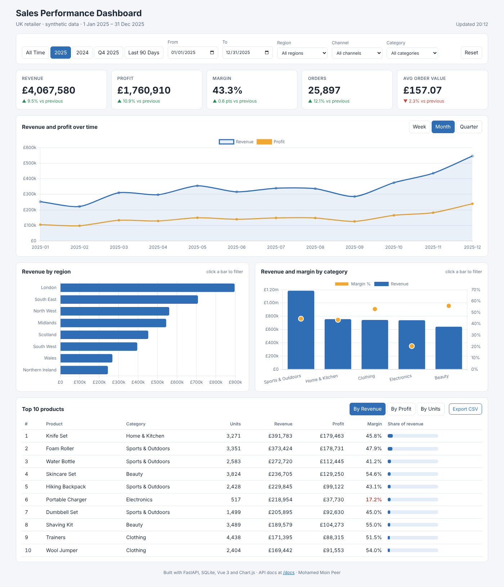

# Sales Performance Dashboard

An interactive sales dashboard for a (synthetic) UK retailer. A **FastAPI** backend serves KPIs and breakdowns from a
**SQLite** database; a **Vue 3 + Chart.js** frontend shows KPI cards with period-on-period change, a revenue and
profit trend, regional and category breakdowns you can click to filter, and a top-products table with CSV export.



## Highlights

* **One filter model for everything.** Date range, region, channel and category are validated once in FastAPI and
  passed as a single `Filters` object to every query, so all charts always describe the same data.
* **Fair comparisons.** KPI cards compare with the previous comparable period (2025 vs 2024, Q4 vs Q3, or the same
  number of days before a custom range).
* **Cross-filtering.** Click a region or category bar to filter the whole dashboard; the clicked chart keeps showing
  all bars with the selection highlighted.
* **Safe SQL.** User values are only ever SQL parameters; sort columns come from a whitelist. A test tries an SQL
  injection string and checks it matches nothing.
* **Numbers that reconcile.** Tests check that regions, categories, channels and the trend each add back up to the
  KPI total for several filter combinations.
* **Works offline.** Vue and Chart.js are bundled in `frontend/vendor/`, so no CDN or Node.js build step is needed.
* **26 automated tests** covering data integrity, query reconciliation and the API contract.

## Key results (2025 vs 2024)

| Metric | 2025 | Change |
|---|---|---|
| Revenue | £4.07m | +9.5% |
| Profit | £1.76m | +10.9% |
| Margin | 43.3% | +0.6 pts |
| Orders | 25,897 | +12.1% |
| Average order value | £157.07 | -2.3% |

* **Online is the growth engine:** online revenue grew 22.1% while in-store was flat (-1.5%); online is now 52% of revenue.
* **Seasonality:** Q4 delivers about a third of annual revenue, with December the peak month.
* **Margin watch:** Electronics is 18.2% of revenue but only 8.6% of profit (20% margin).
* **Growth came from more orders, not bigger baskets** (orders +12.1%, average order value -2.3%).

Full findings: [`outputs/results/insights.md`](outputs/results/insights.md), generated from the data.

## Tech stack

| Layer | Tools |
|---|---|
| Data | Python (NumPy, pandas) generator → SQLite |
| Backend | FastAPI, Pydantic response models, Uvicorn |
| Frontend | Vue 3 (no build step), Chart.js 4, plain CSS (responsive) |
| Reporting | matplotlib charts and CSV/JSON exports in `outputs/` |
| Testing | pytest, FastAPI TestClient |

## Project structure

```
sales-dashboard/
├── src/sales_dashboard/
│   ├── config.py           # paths and settings (SALES_DB_PATH can be overridden)
│   ├── generate_data.py    # builds the synthetic SQLite database
│   ├── queries.py          # all SQL + the Filters object and previous-period rule
│   ├── schemas.py          # Pydantic response models (power the /docs page)
│   ├── api.py              # FastAPI app: /api/* endpoints + serves the frontend
│   ├── export_results.py   # writes outputs/results and outputs/figures
│   └── __main__.py         # CLI: build | export | serve | all
├── frontend/
│   ├── index.html          # dashboard layout (Vue template)
│   ├── app.js              # data fetching, filters, Chart.js charts
│   ├── styles.css
│   └── vendor/             # Vue 3 and Chart.js (bundled, with licences)
├── tests/                  # 26 tests: data, query reconciliation, API
├── outputs/
│   ├── results/            # kpi_summary.json, *_summary.csv, top products, insights.md
│   └── figures/            # static charts used in the report
├── docs/
│   ├── API.md              # endpoint reference
│   ├── architecture.png
│   ├── dashboard_screenshot.png
│   ├── presentation/       # Sales_Dashboard_Presentation.pptx (~25 min, speaker notes)
│   └── report/             # Sales_Dashboard_Final_Report.docx / .pdf
├── data/                   # sales.db is created here on first run (git-ignored)
├── scripts/                # run_dashboard.bat / .sh, copy_vendor.js
├── requirements.txt        # Python packages
├── package.json            # frontend packages (optional, already bundled)
├── pyproject.toml
├── PROJECT_SUMMARY.md
└── LICENSE
```

## Getting started (VS Code)

Requires Python 3.10+.

```bash
# 1. Create and activate a virtual environment
python -m venv .venv
.venv\Scripts\activate          # Windows
# source .venv/bin/activate     # macOS / Linux

# 2. Install
pip install -r requirements.txt
pip install -e .

# 3. Build the database and export results
python -m sales_dashboard all

# 4. Start the dashboard
python -m sales_dashboard serve
```

Open **http://127.0.0.1:8000** for the dashboard and **http://127.0.0.1:8000/docs** for the interactive API docs.
Alternatively: `uvicorn sales_dashboard.api:app --reload` (auto-reloads when you edit the code).

Run the tests:

```bash
pytest
```

## API

| Endpoint | Purpose |
|---|---|
| `GET /api/filters` | Allowed regions, channels, categories and date range |
| `GET /api/kpis` | Revenue, profit, margin, orders, AOV and % change vs previous period |
| `GET /api/revenue-trend?grain=month` | Trend by day, week, month or quarter |
| `GET /api/regions`, `/api/categories`, `/api/channels` | Breakdowns with margin and share |
| `GET /api/top-products?limit=10&sort=revenue` | Best products by revenue, profit or units |
| `GET /api/export/products.csv` | CSV download for the current filters |

All accept `start`, `end`, `region`, `channel` and `category`. See [`docs/API.md`](docs/API.md).

## Data

The data is **synthetic**, created by `generate_data.py` (fixed seed, so everyone gets identical numbers): 48,994
order lines over 2024-2025 across 8 UK regions, 2 channels and 40 products in 5 categories, with built-in growth,
seasonality, weekend effects and discounts. Each order contains one product line, a simplification noted in the
report. Small differences in regional growth are random variation rather than designed effects.

## Limitations and next steps

* Synthetic data; connecting to a real warehouse would only require changing `queries.py`.
* Single-line orders, so basket analysis is not possible.
* Next: user authentication, caching for large datasets, a forecast line, and deployment (e.g. Render or Azure App Service).

## Author

**Mohamed Moin Peer**, MSc Data Analytics, Queen's University Belfast.
[GitHub](https://github.com/MOIN-PEER)

Licensed under the MIT Licence. Vue and Chart.js are MIT-licensed; their licences are in `frontend/vendor/`.
